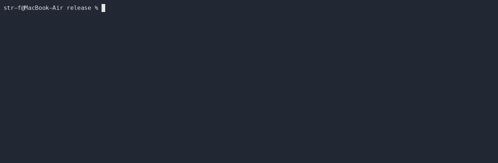

# Oxidian Client

Oxidian Client - A headless Minecraft client written in Rust, supporting protocol version 776 (Minecraft 26.2) 

At the moment the client is still in early development and is not yet usable as a game client. It can log in and stay connected, but world, rendering and input are still missing. The project is aiming to have a client that is faster and more efficient than the vanilla Java client.



## Quick Start
> [!WARNING]
> Requires a running Minecraft Java 26.2 Server and Rust installed

1. Start a server: see [Setting up the Server](#setting-up-the-server)
2. Download from crates.io: ```cargo install oxidian_client```
3. Run the client with ```oxidian_client```
4. For more information see [Running Locally](#running-it-locally)


## Features
- Command-line arguments to set the IP, port, and username
- Handling the required packets in the Status, Login, and Configuration phase
- Handling compression of the packets with encoding and decoding them
- Logging in and staying logged into the server by replying to keep alive packets
- Accepting player position update packets and responding to them as needed
- The client is robust because it does not crash on unexpected packets or server disconnects.
- Receiving registry data from the server and using local registry data to handle the received data: this is needed because the server sends some registry entries without data, which are filled in from local files.

## Running it Locally
### Requirements
- Rust: tested with 1.96.0
- Java (for the Server) >= JDK/JRE 25
- The Server: [server.jar 26.2](https://piston-data.mojang.com/v1/objects/823e2250d24b3ddac457a60c92a6a941943fcd6a/server.jar)

### Setting up the Server
1. Run the server one time with ```java -jar server.jar --nogui```, it will stop and ask you to accept the EULA
2. Set ```eula=true``` in the eula.txt file
3. In the server.properties file, set ```online-mode=false``` to allow the client to connect without authentication (not supported yet)
4. Run the server again with ```java -jar server.jar --nogui```

### Usage
```
Usage: oxidian_client [OPTIONS]

Options:
      --host <HOST>          [default: localhost]
      --port <PORT>          [default: 25565]
      --username <USERNAME>  [default: OxidianClientUsr]
      --assets <ASSETS>      [env: OXIDIAN_ASSETS=]
  -h, --help                 Print help
```

### Setting up local registry data
> **Not needed for running the client.** The client can run without it because the saved registry data is not yet used in the client.

> Fixes the warning:  ```assets/data not found. Registry entries without server data will be missing.```

**For this guide you need a legitimate Minecraft account to download the assets which contain the registry data. I do not support the usage of illegally obtained Minecraft**

1. Create an ```assets``` folder besides the executable (if it is elsewhere, use the ```--assets``` flag)
2. Acquire the Minecraft 26.2 Client.jar
3. Unzip the client.jar with a zip tool by your choice
4. Go in to the unzipped folder and copy the ```data``` folder into the assets folder you created in step 1. The path should look like this: ```assets/data/minecraft``` 

> [!WARNING]
> Don't forget to copy the .mcassetsroot file, sometimes it is hidden by default in your file manager

## How it works
The client needs to receive packets at any time, because the server is not sending them in an interval or fixed order; also, the client can't stop when waiting for the server.

This is because I made the main and network parts of the client separate async tasks, connected by channels, so the network task is not blocking the main task, which keeps the client running when waiting for packets or when the server is not responding.

There are two channels: one from the network task to the main task, which is sending the received events from the network to the main task for handling, and one from the main task to the network task, which is sending network commands back for the network task to handle.

## Roadmap
- [x] Handshake, login, configuration, keep alive
- [ ] Chunk data
- [ ] World model
- [ ] Rendering
- [ ] Input and movement
- [ ] Entities

## Credits
- [Minecraft Protocol Wiki](https://minecraft.wiki/w/Minecraft_Wiki:Projects/wiki.vg_merge/Protocol?oldid=3786274)
- Crates used in this project: bytes, clap, env_logger, fastnbt, flate2, log, serde_json, tokio, uuid

## License
GPL-3.0-or-later, see [LICENSE](LICENSE).
